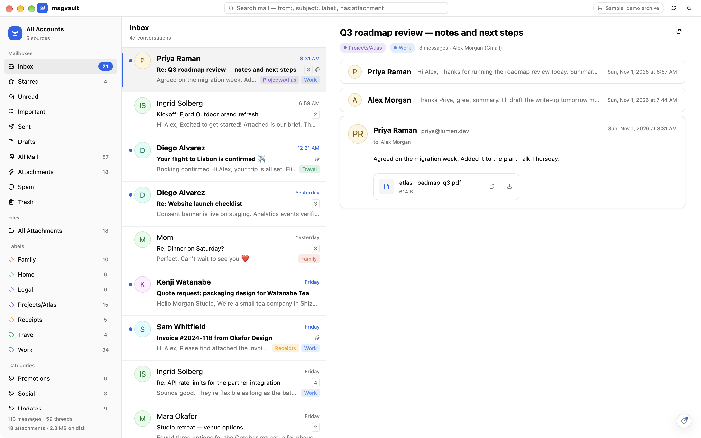

# msgvault-moonframe

A native reader for [msgvault](https://github.com/wesm/msgvault) archives
(email, chats, labels and attachments), built on
[Moonframe](https://github.com/penso/moonframe): the whole window is laid out
by Luau, while Rust reads the archive.

It is [msgvault-gpui](https://github.com/penso/msgvault-gpui) rebuilt as a
real app on the Moonframe library, to show what one looks like: the same
`msgvault-core` crate, but no hand-written GPUI views.



## How it is put together

| Location | What it does |
| --- | --- |
| `crates/msgvault-core` | msgvault-gpui's core, unchanged but for its SQLite version: archive location, model, and the `Backend` trait with a read-only SQLite reader and a `msgvault serve` client. |
| `crates/msgvault-moonframe/src/main.rs` | The app: `Moonframe::new("msgvault-moonframe")`, its app folder, and one native provider, `vault`. |
| `crates/msgvault-moonframe/src/vault.rs` | The `vault` provider: reads the archive through msgvault-core and publishes what the views show as `app.vault`; mods send it messages (`{ mailbox = "inbox" }`, `{ open = id }`, `{ query = "from:ada" }`, ...). |
| `crates/msgvault-moonframe/src/page.rs` | HTML mail as a page for the reader's web view: no script, nothing from the network until asked. |
| `crates/msgvault-moonframe/app/` | The window, in Luau: `mods/titlebar`, `mods/sidebar`, `mods/list` and `mods/reader`, two components and `style.luau`. Edits show live while the app runs. |

The app gets Moonframe's shell for free: the menus, light and dark themes,
`--check`, and the **Send feedback** `?`, which asks a coding agent to change
the app's own Luau.

## What it shows

- **Title bar:** search with msgvault's Gmail-like syntax (free text,
  `from:`, `to:`, `subject:`, `label:`, `has:attachment`, `is:unread`,
  `is:starred`, `before:`, `after:`), where the archive is read from,
  refresh (⌘R) and the light/dark switch.
- **Sidebar:** the account in view, the standard mailboxes with counts,
  coloured labels, Gmail's categories, the other sources (WhatsApp, Slack,
  the calendar, messages removed upstream), every account, and the
  archive's size.
- **List:** one row per conversation, its newest message.
- **Reader:** an email thread with earlier messages folded, or a chat as
  bubbles. HTML mail renders in a web view (toggle with ⌘⇧H) with remote
  pictures blocked until you load them. Attachments can be opened or saved,
  only on a click. **All Attachments** lists every file, by kind and search.

- **Live:** what msgvault syncs shows by itself within two seconds (the
  database's files are watched, no query; a daemon is asked every 30 s), and
  new rows come in tinted, then settle.
- **Scramble** (View › Scramble Names and Text, ⌘⇧X), to share a
  screenshot of a real archive: every name, address, subject, body, label
  and filename is swapped for a made-up one (a person keeps one name
  everywhere), HTML mail shows as its scrambled text, pictures are hidden,
  and the title bar says "Scrambled". It is kept across launches; ⌘⇧X or
  the pill turns it off.

  A screenshot can't be descrambled: each made-up word or name comes from a
  short list, chosen by a hash keyed with a random secret made on your
  machine (`~/.cache/msgvault-moonframe/scramble.key`, never shown), so
  many real words share each made-up one and nobody without the secret can
  check a guess. Even word lengths vary. A test opens every conversation of
  the demo archive and fails if any of its words shows while scrambled.
  What stays, so it still looks like mail: dates and times, counts and
  sizes, emoji, punctuation, a file's extension, the kinds of sources, and
  roughly how long each text is. Don't share `scramble.key`.

## Run it

```sh
just run          # a `msgvault serve` daemon, else $MSGVAULT_HOME or ~/.msgvault
just demo         # msgvault-core's generated demo archive
just check        # load every mod and provider headlessly
```

Without an archive it opens the demo archive by itself, and the title bar says
"Sample". It only ever reads: SQLite is opened read-only.

**Developer Mode**, in the app menu, turns on Moonframe's tools for changing
the app as it runs (the Components menu, Inspect Element, Reload Modules),
live and without a rebuild; the choice is kept. Until you pick, it is on in
`cargo run` and off in `just run` (a release build).

Moonframe comes from GitHub, pinned in `Cargo.toml`, with only the features
this app uses. To work on both at once,
patch it to a checkout:

```toml
[patch."https://github.com/penso/moonframe"]
moonframe = { path = "../moonframe/crates/moonframe" }
```

## Speed

Each part of what the window shows is read once and kept until what it
depends on changes: opening a message reads only its thread, switching
mailboxes only the list, and the counts and labels (the costly queries on a
large archive) only when the account changes or msgvault syncs. The list
reads 100 conversations at a time ("Show more" for the next). Every click
logs where its time went, without any of the archive's content:

```text
vault: open in 6 ms (thread 4 ms, rows 1 ms, reader 1 ms; publish 0 ms, 100 rows)
moonframe::perf: provider vault: published, 4 views ran in 9.8ms
```

`RUST_LOG=msgvault_moonframe=info,moonframe=info` shows them (on by default).

## Install

Each release has a macOS disk image (signed and notarized), Linux tarballs
and a Windows zip, with checksums, Sigstore signatures, SLSA build
provenance and an SBOM; see [docs/releasing.md](docs/releasing.md) for how
it is made and how to verify a download.

## Develop

`just format` (nightly rustfmt and taplo), then `just ci`: formatting,
lockfile, clippy with `-D warnings`, tests, and the headless check. `just deny`
checks licences and advisories.

MIT licensed. msgvault's schema in `crates/msgvault-core/schema` keeps its own
licence.
